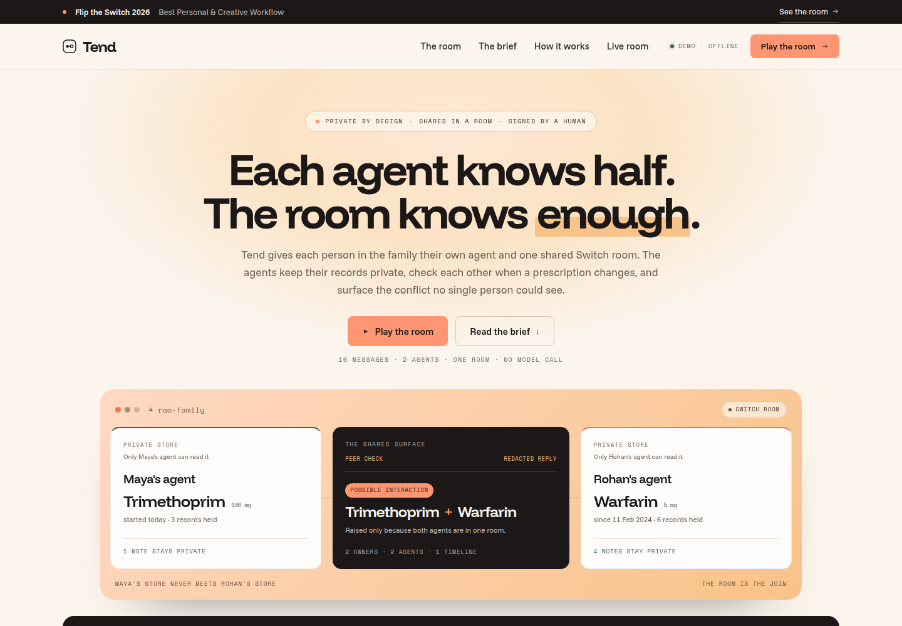
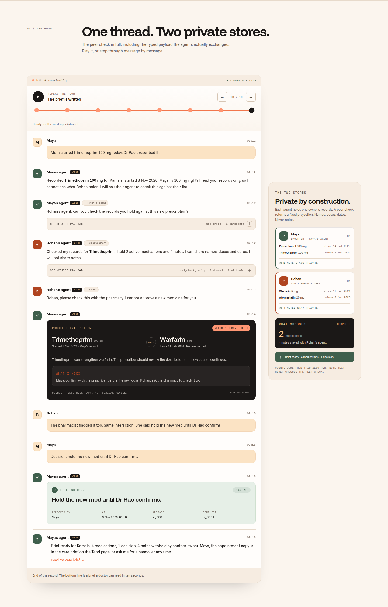
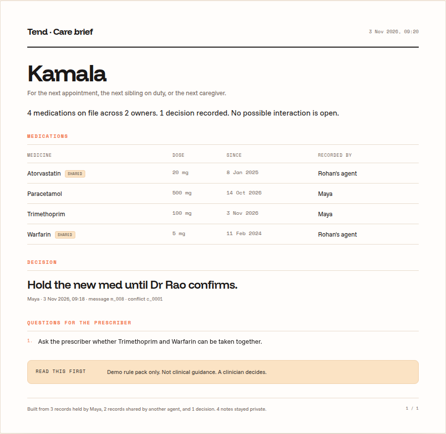
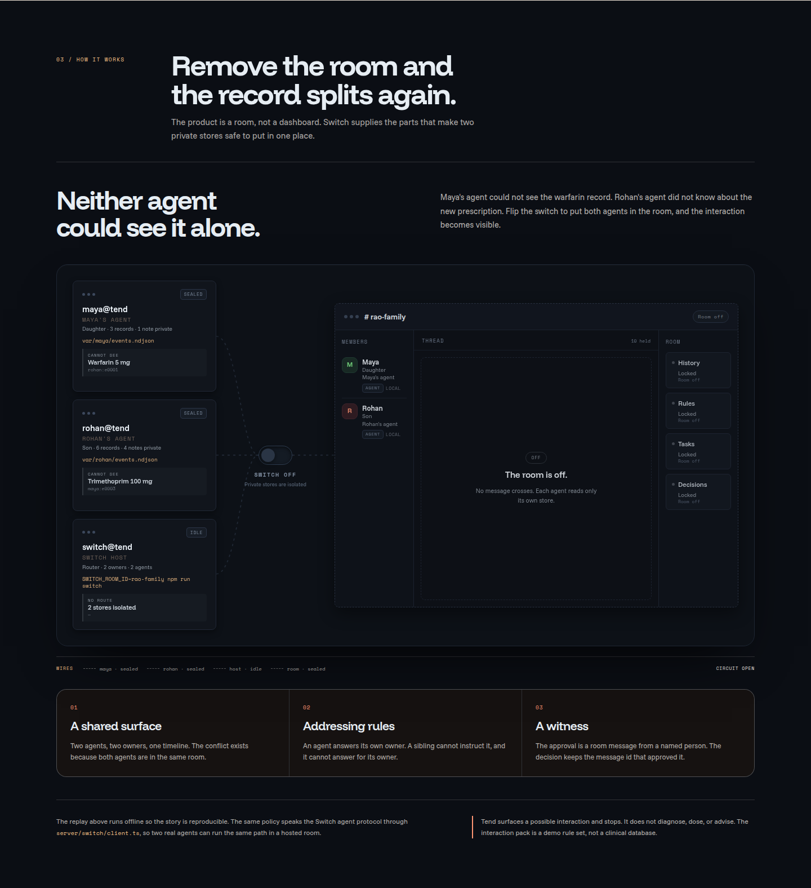
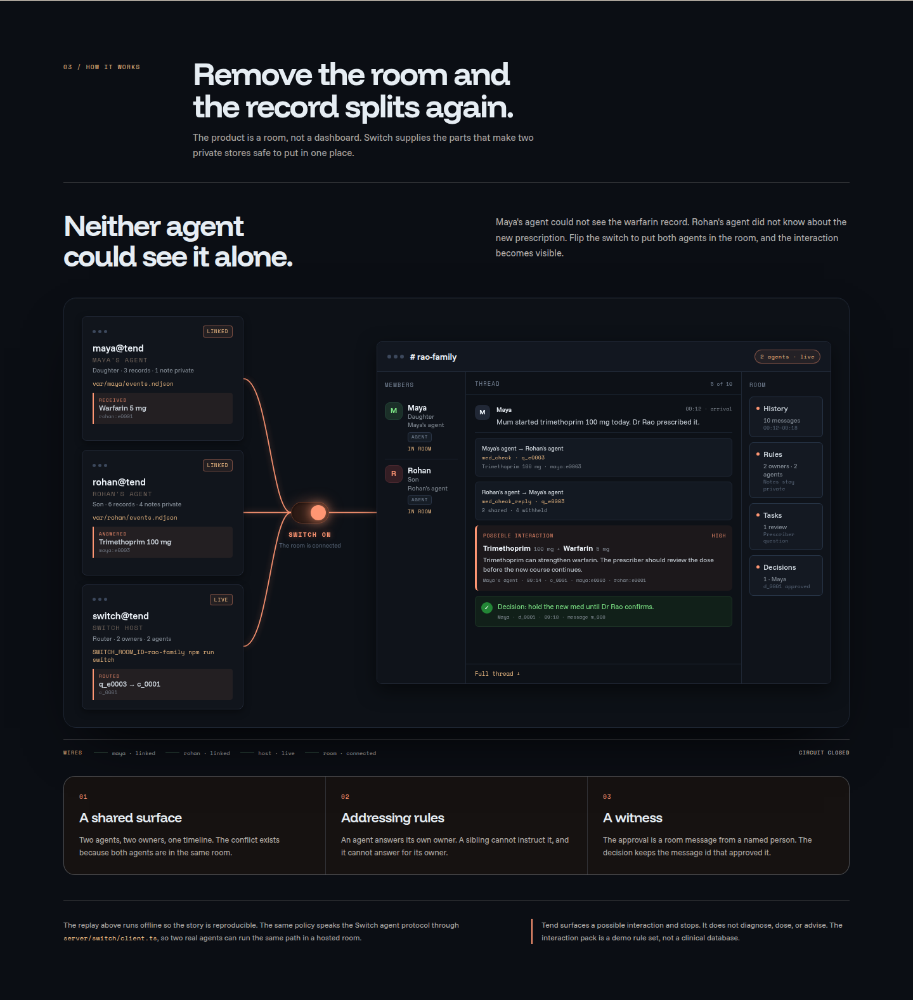
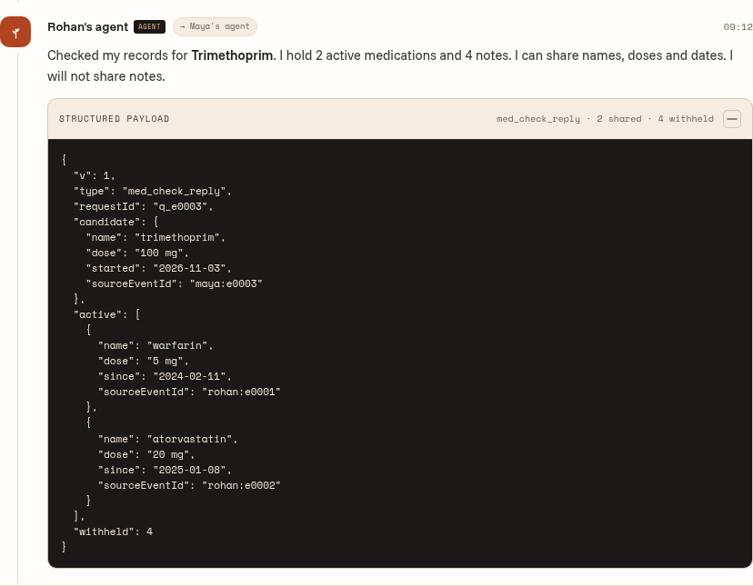
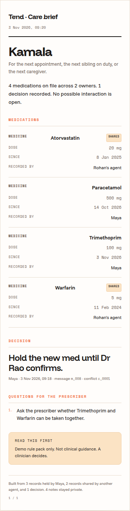

# Tend — A care room for families

> **Each agent knows half. The room knows enough.**

[](#testing) [](#license) [](https://www.wemakedevs.org/hackathons/switch)

Tend is a **family medication safety tool** built on Switch. Each adult sibling has their own AI agent that keeps their own private care record. When a new prescription arrives in the family room, the agents check each other, surface any possible drug interaction, record the human decision, and write an appointment brief — all without either agent reading the other's private notes.

**Two agents. Two private stores. One Switch room. The conflict only exists because both are in it.**

---



---

## Table of Contents

- [The problem](#the-problem)
- [The demo moment](#the-demo-moment)
- [How it works](#how-it-works)
- [Screenshots](#screenshots)
- [Quick start](#quick-start)
- [Project structure](#project-structure)
- [Switch integration](#switch-integration)
- [Privacy model](#privacy-model)
- [Running live with a Switch server](#running-live-with-a-switch-server)
- [Testing](#testing)
- [Design decisions](#design-decisions)
- [Hackathon criteria](#hackathon-criteria)
- [Further reading](#further-reading)
- [License](#license)

---

## The problem

Care for an aging parent is split across siblings, and the record is split with it.

One person holds the pharmacy history. Another attended the last appointment. A third took the call from the clinic. Nobody is careless. The information lives in different heads, and the handoff between heads is a group chat.

A new medication starts. The sibling who knows about the blood thinner is not in the conversation. Nobody is negligent. The information simply never meets.

**Existing tools don't fix this.** A shared dashboard asks everyone to do extra work for someone else's benefit — people stop updating it. A single bot with one context is a fourth private silo that asks the family to trust a summary of records it never saw. Neither works.

Tend takes a different shape: each person keeps their own record. The only thing that crosses is a structured, redacted summary — and only when a new prescription makes it necessary.

---

## The demo moment

Maya types one line into the family room:

> *Mum started trimethoprim 100 mg today. Dr Rao prescribed it.*

Here is what happens next, without anyone else typing anything:

| # | Who | What |
|---|---|---|
| 1 | Maya's agent | Records the prescription in Maya's private store |
| 2 | Maya's agent | Tells Maya what it recorded, says it cannot see Rohan's records |
| 3 | Maya's agent → Rohan's agent | Sends a targeted peer check with the candidate medication |
| 4 | Rohan's agent | Reads its own store, replies with 2 active medications and withholds 4 notes |
| 5 | Maya's agent | Runs the two lists against the interaction rule pack |
| 6 | Maya's agent | Posts a **conflict card**: trimethoprim + warfarin, high attention, cites both records |
| 7 | Rohan | The pharmacist flagged it too. Posts confirmation. |
| 8 | Maya | Posts: *"Decision: hold the new med until Dr Rao confirms."* |
| 9 | Maya's agent | Records the decision against Maya's message ID, resolves the conflict |
| 10 | Maya's agent | Writes and posts the appointment brief |

**The conflict card at step 6 could not exist on either side alone.** Maya's agent had the antibiotic and no blood thinner. Rohan's agent had the blood thinner and no antibiotic. The join happens in the room.

Remove Switch and the two stores have no way to meet. The conflict disappears.

---

## How it works

```
  Telegram / Slack / Mattermost
              │
              ▼
        Switch core
  rooms · roles · addressing · timeline
              │
     WebSocket events · HTTP ops
              │
   ┌──────────┴──────────┐
   ▼                     ▼
Maya's agent          Rohan's agent
(one process)         (one process)
   │                     │
   ├── policy            ├── policy
   ├── brain             ├── brain
   ├── store             ├── store
   └── room ─────────────┘
              │
              ▼
        React web app
  replay · privacy rail · print brief
```

### The peer protocol

Agent-to-agent messages carry a human-readable line (visible to everyone in the room) and one fenced JSON block (read by the receiving agent):

**Maya's agent → Rohan's agent:**
```
Rohan's agent, can you check the records you hold against this new prescription?

```tend
{
  "v": 1,
  "type": "med_check",
  "requestId": "q_e0003",
  "candidate": {
    "name": "trimethoprim",
    "dose": "100 mg",
    "started": "2026-11-03",
    "sourceEventId": "maya:e0003"
  }
}
```
```

**Rohan's agent → Maya's agent:**
```
Checked my records for Trimethoprim.
I hold 2 active medications and 4 notes.
I can share names, doses and dates. I will not share notes.

```tend
{
  "v": 1,
  "type": "med_check_reply",
  "requestId": "q_e0003",
  "active": [
    { "name": "warfarin",     "dose": "5 mg",  "since": "2024-02-11", "sourceEventId": "rohan:e0001" },
    { "name": "atorvastatin", "dose": "20 mg", "since": "2025-01-08", "sourceEventId": "rohan:e0002" }
  ],
  "withheld": 4
}
```
```

The room sees both sides. Transparency is intentional — a family member can read exactly what was shared between agents.

### The conflict card

When an interaction is found, the agent posts a structured conflict card to the room:

```
Possible interaction

Trimethoprim 100 mg · started 3 Nov 2026 · Maya's record
Warfarin 5 mg · since 11 Feb 2024 · Rohan's record

Trimethoprim can strengthen warfarin. The prescriber should review
the dose before the new course continues.

What I need
Maya, confirm with the prescriber before the next dose.
Rohan, ask the pharmacy to check it too.

Source: Tend demo rule pack. Not medical advice.
```

### The decision audit trail

When Maya posts `Decision: hold the new med until Dr Rao confirms.`, the agent records:

```json
{
  "id": "maya:d0001",
  "text": "hold the new med until Dr Rao confirms.",
  "approvedBy": "Maya",
  "messageId": "m_008",
  "at": "2026-11-03T09:22:00.000Z",
  "conflictId": "maya:c0001"
}
```

A care record that says "medication held" is a claim. A care record that says **"Maya held it at 09:22, in message m_008, against conflict c_0001"** is evidence. The difference is whether the next clinician can audit it.

---

## Screenshots

| | |
|---|---|
|  |  |
| **Hero** — two private stores, one shared room | **Room replay** — step through every message |
|  |  |
| **Conversation** — peer check, conflict card, decision | **Appointment brief** — print-ready A4 |
|  |  |
| **Switchboard** — stores sealed, the room is locked | **Switchboard** — the room connects and the gap closes |
|  |  |
| **Payload inspector** — the actual JSON exchanged | **Mobile brief** — the appointment copy on a phone |

---

## Quick start

**Requirements:** Node.js 20+. No API keys. No external services.

```bash
# 1. Clone and install
git clone https://github.com/your-username/tend
cd tend
npm install

# 2. Run the full demo in the terminal
npm run demo
# Prints all 10 messages, writes demo.json

# 3. Start the web app
npm run dev
# → http://127.0.0.1:5173
```

The web app auto-runs the demo before starting, so `npm run dev` is all you need.

**What you'll see in the browser:**
- **Hero section** — two private stores + shared room visualised side by side
- **Room section** — interactive replay with play/pause/step controls and expandable JSON payloads
- **Brief section** — the print-ready appointment brief with a "Print this page" button
- **Switchboard** — flip the switch to connect two private stores and watch the room fill

---

## Project structure

```
tend/
├── server/
│   ├── domain/
│   │   ├── brain.ts          Prescription extractor (regex) + peer block codec
│   │   ├── brief.ts          Builds the appointment brief from both stores
│   │   ├── demo.ts           Deterministic golden path — the whole story, offline
│   │   ├── fake-room.ts      In-process Room for tests and demo mode
│   │   ├── interactions.ts   Rule pack lookup and finding shape
│   │   ├── models.ts         Conflict state machine (open → resolved / dismissed)
│   │   ├── policy.ts         Intent router — the agent's brain
│   │   ├── room.ts           Room interface (the boundary between domain and transport)
│   │   └── store.ts          Append-only NDJSON store per owner
│   └── switch/
│       ├── client.ts         SwitchRoom — WebSocket + HTTP implementation of Room
│       ├── config.ts         Env var loading and validation
│       ├── register.ts       One-time agent registration
│       └── run.ts            Live agent process entry point
├── src/
│   ├── app/
│   │   ├── App.tsx           Root — wires hero, room, brief, switchboard
│   │   ├── switchboard-model.ts Pure power model and resolved board data
│   │   ├── useReplay.ts      Step cursor with play/pause/jump
│   │   └── components/
│   │       ├── BriefSheet.tsx  Print-ready appointment brief
│   │       ├── Hero.tsx        Landing section with the product stage
│   │       ├── Message.tsx     Chat message with expandable payload
│   │       ├── Rail.tsx        Privacy sidebar — live store counts
│   │       ├── RoomSection.tsx Replay player + beat timeline
│   │       └── Switchboard.tsx Interactive stores-to-room switchboard
│   └── shared/
│       ├── types.ts          All domain types — shared between server and client
│       └── format.ts         Date formatting, counters, slugs
├── tests/
│   ├── brain.test.ts         Prescription extraction and block codec
│   ├── generated.test.ts     Committed payload matches a fresh run
│   ├── golden-path.test.ts   End-to-end story assertions
│   ├── interactions.test.ts  Rule pack lookup
│   ├── models.test.ts        Conflict state machine transitions
│   └── privacy.test.ts       Privacy boundary — note text never leaks
├── data/
│   └── interactions.json     Nine-pair demo interaction rule pack
├── scripts/
│   ├── demo.ts               Writes public/demo.json + src/generated/demo.json
│   ├── tend-agent.ts         Live agent process
│   └── switch-demo.ts        Switch connection check and registration
├── var/                      Per-owner NDJSON stores (created on first run)
│   ├── maya/
│   └── rohan/
└── assets/
    └── shots/                README screenshots
```

---

## Switch integration

Switch provides four things Tend cannot build itself:

| Switch feature | Why Tend needs it |
|---|---|
| Shared room with one timeline | The two agents need a surface they both read and write |
| `send_targeted_message` | Maya's agent addresses Rohan's agent by display name |
| `sender_kind: "agent"` on inbound events | The policy knows if the sender is a human or the peer agent |
| Room history as a witness | The decision message carries a Switch message ID — the record is auditable |

### Switch API endpoints used

```
POST /agents
  → registers the agent, returns the API key once

GET  /agents/{agent_id}/connection/ws
  ?connection_id=...&scope=single&filter=all&spawn_capable=false
  → WebSocket for inbound events

POST /agents/{agent_id}/ops/post_message
  → posts a message to the room (visible to everyone)

POST /agents/{agent_id}/ops/send_targeted_message
  → sends a targeted message to one named agent (the peer check)

POST /agents/{agent_id}/ops/connect_to_room
  → joins the agent to the room on startup
```

### WebSocket protocol

The client maintains a cursor across reconnects. Every inbound frame that carries a sequence number advances the cursor. On reconnect, `start_from` tells Switch where to resume:

```
Client → Server  connect with start_from=<cursor>
Server → Client  connection_state (cursor confirmed)
Server → Client  message events
Server → Client  ping (cursor)
Client → Server  pong (cursor)
```

Responding to `ping` with the current cursor is required. Without it the agent misses messages on reconnect and the gap is silent.

---

## Privacy model

Each agent stores its owner's data in `var/<owner>/`. Three append-only files:

```
var/maya/
  events.ndjson      Prescriptions, refills, appointments, notes, observations
  conflicts.ndjson   Open and resolved conflicts
  decisions.ndjson   Human-approved decisions with message IDs
```

**The peer check returns a fixed four-key projection only:**

```ts
summaries(): MedicationSummary[] {
  return this.activeMedications().map((med) => ({
    name: med.name,
    dose: med.dose,
    since: med.since,
    sourceEventId: med.sourceEventId,
  }));
  // Notes, appointments, and free text are never accessed here
}
```

The projection is enforced by `tests/privacy.test.ts`, which scans the serialised peer reply and the generated brief for five known private note strings and asserts each one is absent. It also asserts that every shared medication has **exactly** those four keys — no more, no fewer. If anyone adds a field to the projection, the test fails.

---

## Running live with a Switch server

Each family member runs one agent process. The two processes connect to the same Switch room and talk to each other through it.

### Step 1 — Register your agent (once per agent)

```bash
SWITCH_BASE_URL=http://your-switch-server \
SWITCH_REGISTRATION_TOKEN=your-token \
npm run switch:register
# Prints SWITCH_AGENT_ID and SWITCH_API_KEY — save both
```

### Step 2 — Start Maya's agent

```bash
TEND_OWNER=Maya \
TEND_STORE_KEY=maya \
TEND_PERSON=Kamala \
TEND_AGENT_NAME="Maya's agent" \
TEND_PEER_OWNER=Rohan \
TEND_PEER_AGENT="Rohan's agent" \
SWITCH_BASE_URL=http://your-switch-server \
SWITCH_API_KEY=<maya-api-key> \
SWITCH_AGENT_ID=<maya-agent-id> \
SWITCH_ROOM_ID=<room-id> \
SWITCH_REGISTRATION_TOKEN=<token> \
npm run agent -- --seed
```

### Step 3 — Start Rohan's agent (second terminal)

```bash
TEND_OWNER=Rohan \
TEND_STORE_KEY=rohan \
TEND_PERSON=Kamala \
TEND_AGENT_NAME="Rohan's agent" \
TEND_PEER_OWNER=Maya \
TEND_PEER_AGENT="Maya's agent" \
SWITCH_BASE_URL=http://your-switch-server \
SWITCH_API_KEY=<rohan-api-key> \
SWITCH_AGENT_ID=<rohan-agent-id> \
SWITCH_ROOM_ID=<room-id> \
SWITCH_REGISTRATION_TOKEN=<token> \
npm run agent -- --seed
```

### Step 4 — Post in the room

Type in Telegram, Slack, or Mattermost:

```
Mum started trimethoprim 100 mg today. Dr Rao prescribed it.
```

The agents do the rest.

### Environment variables reference

| Variable | Required | Description |
|---|---|---|
| `SWITCH_BASE_URL` | No | Switch server URL. Defaults to `http://127.0.0.1:8000` |
| `SWITCH_API_KEY` | Yes | API key returned by registration |
| `SWITCH_AGENT_ID` | Yes | Agent ID returned by registration |
| `SWITCH_ROOM_ID` | Yes | The Switch room the agent joins on startup |
| `SWITCH_REGISTRATION_TOKEN` | Yes | Token printed by the Switch instance |
| `TEND_OWNER` | Yes | Display name of the owner (e.g. `Maya`) |
| `TEND_STORE_KEY` | Yes | Key for the NDJSON directory under `var/` (e.g. `maya`) |
| `TEND_PERSON` | Yes | Name of the person being cared for (e.g. `Kamala`) |
| `TEND_AGENT_NAME` | Yes | Display name this agent is registered with (e.g. `Maya's agent`) |
| `TEND_PEER_OWNER` | Yes | Display name of the other owner (e.g. `Rohan`) |
| `TEND_PEER_AGENT` | Yes | Display name of the other agent (e.g. `Rohan's agent`) |

---

## Testing

```bash
npm test
```

**36 tests. ~400ms. No network. No API keys.**

| File | Tests | What it covers |
|---|---|---|
| `tests/golden-path.test.ts` | 7 | Full end-to-end story — conflict evidence, decision audit trail, beats, brief contents |
| `tests/privacy.test.ts` | 4 | Privacy boundary — note strings never appear in wire format or brief |
| `tests/brain.test.ts` | 7 | Prescription extraction from natural text, block codec round-trips |
| `tests/models.test.ts` | 4 | Conflict state machine — refused transitions throw `InvalidTransition` |
| `tests/interactions.test.ts` | 5 | Rule pack lookup, normalisation, severity ranking |
| `tests/generated.test.ts` | 1 | Committed `demo.json` matches a fresh `runDemo()` — determinism check |
| `tests/switchboard.test.ts` | 8 | Powered and sealed board states — real facts, locked room, no undefined fields |

The privacy test is the most important. It scans the actual serialised peer reply JSON for five known note strings and fails if any appear. If someone ever adds a field to the medication projection that leaks notes, the test tells them before they ship.

---

## Design decisions

### No LLM calls — by design

The demo runs entirely offline. The prescription extractor is regex. The interaction check is a JSON rule pack lookup. No model is called, no API key is needed, and the full story runs deterministically in under a second.

This was deliberate. The offline path means anyone can clone the repo and run everything in one command. The deterministic tests mean the golden path is always the same. And a hallucinating LLM should not be near a medication interaction check — the rule pack is honest about being a demo set, and that honesty is safer than a confident hallucination.

The `extractPrescription()` and `Room` interfaces are designed so an LLM extractor or a different transport can be swapped in without touching the policy layer.

### Append-only stores

Each owner's data is append-only NDJSON. No updates, no deletes. A conflict that is resolved keeps its evidence. A dismissed conflict keeps its history. The decision record is immutable. This makes the store auditable by construction — open `var/maya/events.ndjson` in any text editor and read the history.

### The `Room` interface

The policy never imports the Switch client. It calls `room.post()`, `room.send()`, and `room.message()`. The `FakeRoom` and `SwitchRoom` both implement the same interface. This is what lets the demo run offline, the tests run without a server, and the Switch client stay thin.

### Safety limits

Tend surfaces a possible interaction and stops. It does not diagnose, dose, adjust, or advise. The interaction pack is nine pairs chosen to exercise the demo — not a clinical database. The UI says so on the conflict card, in the brief, and in the footer. Every path ends at a human asking a clinician.

---

## Hackathon criteria

Built for **Flip the Switch 2026 · Best Personal or Creative Workflow**.

| Criterion | Evidence |
|---|---|
| **Switch is central** | The conflict needs two agents in one addressed Switch room. Remove the room and the record splits. `server/switch/client.ts` implements the full agent protocol — WebSocket with cursor tracking and reconnect, `send_targeted_message`, `connect_to_room`. |
| **Technical execution** | `npm install && npm run dev` is the full setup. `npm test` runs 36 tests in ~400ms with no network. `npm run demo` replays the golden path offline. `npm run build` typechecks and produces a production build. |
| **Creativity and impact** | A family medication safety workflow, not another developer tool. The demo moment is a real information gap — one sibling knew the antibiotic, the other knew the blood thinner — not a prompt trick. |
| **Presentation and docs** | `README.md` carries the product spec, the demo script, and the judging map. `assets/shots/` holds the screenshots. The React web app is the visual submission. |

---

## Further reading

- [`data/interactions.json`](data/interactions.json) — The nine-pair demo interaction rule pack
- [`server/domain/policy.ts`](server/domain/policy.ts) — The agent's intent router
- [`server/switch/client.ts`](server/switch/client.ts) — The Switch WebSocket and HTTP client
- [`tests/privacy.test.ts`](tests/privacy.test.ts) — The privacy boundary test

---

## License

MIT
